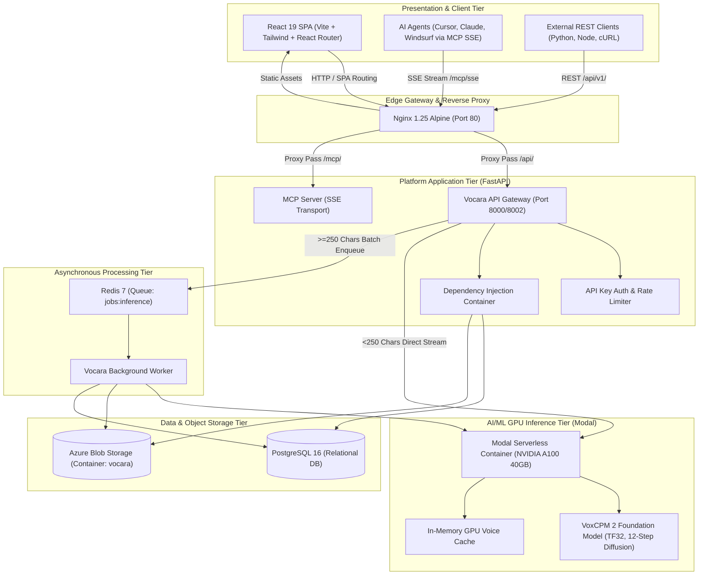
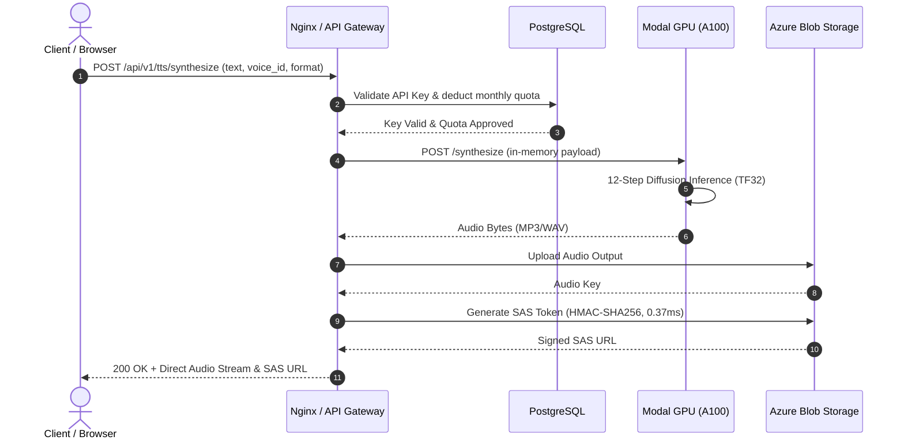
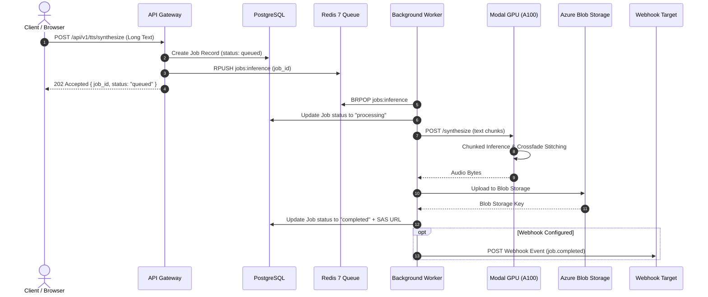

# Vocara Project Architecture Specification

## 1. Executive Summary

Vocara is an enterprise-grade Voice AI platform specializing in ultra-low latency neural text-to-speech (TTS), zero-shot voice cloning, and acoustic voice design. It features bilingual natural synthesis (Khmer and English), Model Context Protocol (MCP) tool integration for AI agents, and a distributed cloud architecture optimized for cost efficiency and sub-second streaming inference.

---

## 2. System Architecture Overview

The system is organized into a decoupled, six-tier architecture:



---

## 3. Core Architectural Tiers

### 3.1 Client & Presentation Tier
- **Framework**: React 19, TypeScript 5.7, Vite 6.1.
- **Styling**: Tailwind CSS 3.4, Radix UI primitives.
- **Navigation & Routing**: `react-router-dom` v7 with full browser history and deep-linking:
  - `/` & `/tts`: Text-to-Speech Studio with instant playback and speed/format sliders.
  - `/voices`: Voice Library with zero-shot cloning (`?action=clone`) and acoustic designer (`?action=design`).
  - `/keys`: API key provisioning, monthly character quotas, and MCP configuration snippets.
  - `/usage`: Real-time character quota tracking and rate limit monitoring.
  - `/jobs`: Asynchronous batch job lookup and audio download (`?job_id=<uuid>`).
- **State Management**: Model-View-Controller (MVC) pattern with custom React hooks (`useTTSController`, `useVoiceController`, `useKeyController`, `useWebhookController`, `useUsageController`).

### 3.2 Gateway & Platform API Tier
- **Framework**: FastAPI (Python 3.11/3.13), Uvicorn ASGI.
- **Design Pattern**: Hexagonal / Clean Architecture (Domain Ports & Adapters) with central Inversion of Control (IoC) dependency injection container (`vocara.container.Container`).
- **Security & Hardening**:
  - SHA-256 API key authentication with per-environment cryptographic salt (`API_KEY_SALT`).
  - Rate limiting (token bucket / fixed window via Redis).
  - Configurable `CORS_ORIGINS` supporting comma-separated strings and JSON arrays.
  - Production security validation halting startup if default development secrets or `DEBUG=true` are detected.
- **MCP Integration**: SSE (Server-Sent Events) endpoint at `/mcp/sse` allowing AI agents to discover tools (`synthesize_speech`, `list_voices`, `clone_voice`, `check_job_status`).

### 3.3 Asynchronous Task Queue & Background Worker
- **Task Broker**: Redis 7 Alpine (`vocara-redis`, queue: `jobs:inference`).
- **Worker Process**: `vocara-worker` (`vocara.worker.main`).
- **Job Lifecycle**:
  - Jobs with text length $\ge 250$ characters are pushed to Redis as `queued`.
  - The worker atomically pops jobs (`BRPOP`), updates status to `processing`, and invokes the GPU inference engine.
  - The synthesized audio is uploaded directly to Azure Blob Storage.
  - The job record is updated to `completed` with audio SAS URL and metrics.
  - If configured, an HTTP webhook callback is dispatched to subscriber endpoints.

### 3.4 Database & Persistence Tier
- **Database Engine**: PostgreSQL 16 Alpine (`vocara-postgres`) on port 5432.
- **Driver & ORM**: `asyncpg` async connection pool + SQLAlchemy 2.0 async ORM.
- **Schema Migration**: Alembic version-controlled migrations (`alembic upgrade head`).
- **Relational Tables**:
  1. `api_keys`: Encrypted key prefixes, hashed secrets, rate limits, monthly quotas.
  2. `voices`: Built-in, cloned, and designed voice profiles with acoustic attributes.
  3. `jobs`: Asynchronous batch synthesis state, character count, output URLs, error messages.
  4. `usage_records`: Fine-grained character consumption logs per API key.
  5. `webhooks`: Registered destination URLs and subscribed event types (`job.completed`, `job.failed`).
  6. `alembic_version`: Active database migration tracking.

### 3.5 Storage Tier
- **Primary Backend**: Azure Blob Storage (Container: `vocara` in account `miniprojectstorage`).
- **Access Pattern**: Secure Shared Access Signature (SAS) tokens generated in-memory via HMAC-SHA256 (0.37 ms latency) with configurable time-to-live.
- **Fallback**: Local file system storage adapter (`vocara.infrastructure.storage.local.LocalStorageAdapter`).

### 3.6 GPU Inference Tier (Modal)
- **Deployment Platform**: Modal Serverless Container (`vocara-voxcpm-fastapi-app`).
- **Hardware Acceleration**: NVIDIA A100 (40GB) with 1,555 GB/s HBM2 bandwidth.
- **Optimizations**:
  - PyTorch TensorFloat-32 (`TF32`) enabled on Tensor Cores (`torch.backends.cuda.matmul.allow_tf32 = True`).
  - Pre-cached model weights baked into image layer (`openbmb/VoxCPM2`).
  - 12-step diffusion inference with Classifier-Free Guidance (`CFG = 1.8`).
  - GPU host in-memory LRU voice reference cache (`self.voice_cache`) eliminating repeated audio encoding.
  - Natural sentence boundary splitting preventing staccato pauses in Khmer script.
  - Scaledown window of 15 minutes (`scaledown_window=900`) maintaining a warm container during active sessions.

---

## 4. End-to-End Data Flow Diagrams

### 4.1 Direct Streaming Synthesis Flow (<250 characters)



### 4.2 Asynchronous Batch Synthesis Flow (>=250 characters)



---

## 5. Repository Structure & Module Topology

```text
Vocara/
├── .github/
│   └── workflows/
│       ├── ci.yml                 # Automated CI: Lint, Typecheck, 81 Tests, Docker Build
│       └── deploy.yml             # CD Pipeline: SSH Production Server Deployment
├── backend/
│   ├── alembic.ini                # Database migration configuration
│   ├── Dockerfile                 # Multi-stage Python 3.11 container build
│   ├── pyproject.toml             # Dependencies & CLI entry points (uv / pip)
│   ├── migrations/                # Alembic database revision scripts
│   ├── src/
│   │   └── vocara/
│   │       ├── api/               # FastAPI endpoints, dependencies, middleware
│   │       ├── core/              # Config, security, exceptions, logging
│   │       ├── domain/            # Pure entities, value objects, ports (interfaces)
│   │       ├── infrastructure/    # Database repos, Azure storage, inference engines
│   │       ├── mcp/               # Model Context Protocol SSE server & tool definitions
│   │       ├── services/          # Business logic (TTS, Voice, Auth, Usage, Webhook)
│   │       ├── utils/             # Audio processing, normalization, chunking
│   │       └── worker/            # Asynchronous Redis background worker handler
│   └── tests/                     # 81 Unit & integration tests
├── docker/
│   └── postgres/
│       ├── Dockerfile             # Custom PostgreSQL 16 container
│       └── init.sql               # Extension enablement (uuid-ossp, pgcrypto)
├── docker-compose.prod.yml        # Full 5-service production container orchestration
├── docker-compose.db.yml          # Local database & cache services (Postgres + Redis)
├── Documents/                     # Technical specifications and architectural docs
├── frontend/
│   ├── Dockerfile                 # Multi-stage Node 20 builder + Nginx 1.25 runtime
│   ├── nginx.conf                 # Production reverse proxy, SPA fallback, SSE config
│   ├── package.json               # Frontend dependencies (React 19, Tailwind, Vite)
│   └── src/
│       ├── controllers/           # API client and MVC state controllers
│       ├── models/                # TypeScript interface definitions
│       └── views/                 # React UI components and routed pages
└── scripts/
    ├── modal_voxcpm_app.py        # Modal serverless GPU inference microservice
    ├── test_modal_voxcpm_live.py  # Live inference and voice cloning verification test
    ├── benchmark_azure_storage.py # Azure Blob SAS token latency benchmark
    └── test_async_worker_live.py  # Async worker queue end-to-end integration test
```

---

## 6. Docker Container Orchestration

The production deployment runs via `docker-compose.prod.yml` with the following service matrix:

| Container Name | Service Image | Ports | Storage Volume | Responsibility |
| :--- | :--- | :--- | :--- | :--- |
| `vocara-frontend-prod` | `nginx:1.25-alpine` | `80:80` | None | Nginx gateway, SPA serving, reverse proxy, SSE streaming |
| `vocara-api-prod` | `vocara-api:latest` | `8000` (internal) | Local audio cache | FastAPI platform API, authentication, MCP tools |
| `vocara-worker-prod` | `vocara-api:latest` | None | Local audio cache | Redis queue consumer, batch audio processing |
| `vocara-postgres-prod` | `postgres:16-alpine` | `5432:5432` | `vocara_postgres_data` | Persistent relational storage for keys, jobs, voices |
| `vocara-redis-prod` | `redis:7-alpine` | `6379:6379` | `vocara_redis_data` | Persistent task queue and rate limit store |

---

## 7. Security & Production Hardening Checklist

- **Zero Hardcoded Secrets**: All keys, database credentials, salts, and endpoints are sourced dynamically from environment variables (`.env`).
- **Cryptographic Key Hashing**: API keys are hashed using `HMAC-SHA256` with high-entropy salts; raw keys are never stored in plaintext.
- **Fail-Safe Startup**: The API refuses to boot in `ENVIRONMENT=production` if `DEBUG=true` or default secrets are detected.
- **Input Validation**: Text length validation, audio format verification, and consent confirmation enforced before cloning.
- **Storage Isolation**: Audio outputs are accessed via temporary, expiring SAS tokens rather than public storage buckets.
