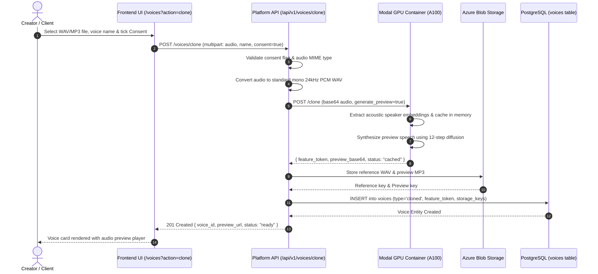
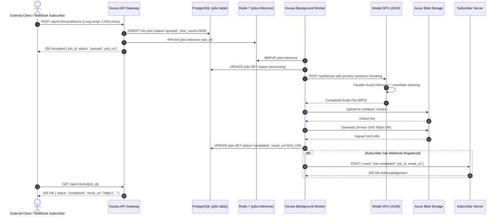
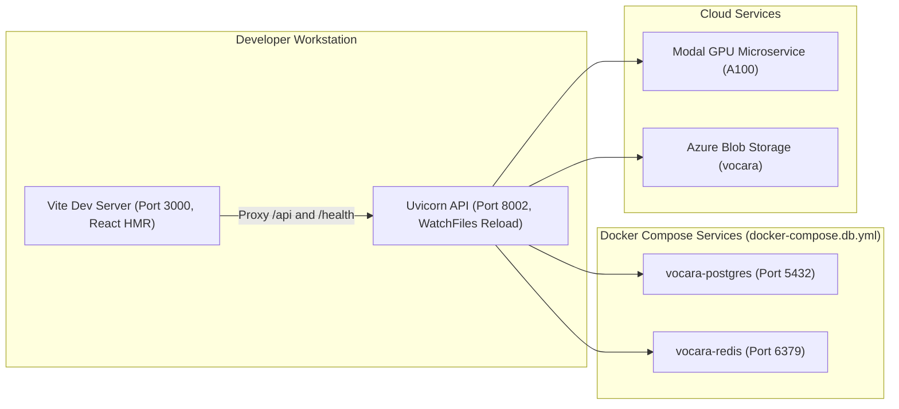
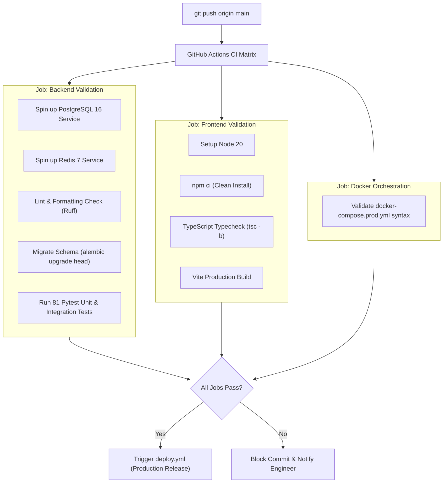

# Vocara Project Workflow Specification

## 1. Executive Summary

This document details the operational, business, and engineering workflows across the Vocara Voice AI platform. It outlines the end-to-end lifecycle of audio generation, voice cloning, asynchronous background execution, AI agent interactions via the Model Context Protocol (MCP), and continuous integration/continuous deployment (CI/CD).

---

## 2. Platform Workflows Overview

```mermaid
flowchart TD
    subgraph W1["1. Auth & Quota Workflow"]
        CreateKey["Mint API Key"] --> KeySalt["Hash with API_KEY_SALT"]
        KeySalt --> SetQuota["Allocate Monthly Char Quota"]
    end

    subgraph W2["2. Voice Management Workflow"]
        UploadSample["Upload 5-15s Audio"] --> Consent["Verify Voice Consent"]
        Consent --> Preprocessing["Normalize & Preprocess Audio"]
        Preprocessing --> GPUCache["Cache Token on A100 GPU"]
        GPUCache --> SaveVoice["Persist Voice Profile (PostgreSQL)"]
    end

    subgraph W3["3. Speech Synthesis Workflow"]
        TextInput["User/Agent Script Input"] --> CheckLength{"Text Length >= 250 chars?"}
        CheckLength -->|No: <250 chars| DirectTTS["Direct Synchronous Stream (<1s)"]
        CheckLength -->|Yes: >=250 chars| AsyncQueue["Enqueue to Redis 7"]
        AsyncQueue --> WorkerProc["Background Worker Pops Job"]
        WorkerProc --> ModalInference["Chunked Inference on Modal GPU"]
        ModalInference --> AudioStitch["Crossfade Audio Stitching"]
        AudioStitch --> AzureUpload["Upload MP3 to Azure Blob"]
        AzureUpload --> WebhookNotify["Dispatch Webhook (job.completed)"]
    end

    subgraph W4["4. AI Agent MCP Workflow"]
        AIAgent["AI Assistant (Cursor / Claude)"] --> SSESubscribe["Connect /mcp/sse"]
        SSESubscribe --> ToolDiscover["Discover TTS & Voice Tools"]
        ToolDiscover --> ExecuteTool["Invoke Tool via SSE Protocol"]
    end

    W1 --> W3
    W2 --> W3
    W1 --> W4
```



---

## 3. End-to-End User & API Workflows

### 3.1 Workflow 1: API Key Lifecycle & Quota Management

1. **Key Generation**:
   - The user opens `/keys` in the dashboard or sends `POST /api/v1/keys/` with a name, rate limit (default: 60 rpm), and monthly character quota (default: 100,000 chars).
   - The server generates a high-entropy secret string formatted as `voc_<prefix>_<secret>`.
   - The secret is hashed using `HMAC-SHA256` with the server's `API_KEY_SALT`.
   - The full secret is returned **once** to the user; only the prefix and cryptographic hash are persisted in PostgreSQL.
2. **Request Authentication & Verification**:
   - Every protected API request carries `X-API-Key: voc_...` or `Authorization: Bearer voc_...`.
   - The authentication middleware parses the prefix, executes an indexed lookup in `api_keys`, and validates the hash in constant time (`hmac.compare_digest`).
3. **Usage Accounting**:
   - Following successful synthesis, the exact character count of the input text is atomically recorded in `usage_records` and deducted from the key's active monthly allocation.
   - If `usage >= char_quota_per_month`, further requests receive `429 Too Many Requests (Quota Exceeded)`.

---

### 3.2 Workflow 2: Zero-Shot Voice Cloning & Consent Verification

This workflow allows users to clone an acoustic voice from a reference audio clip:



---

### 3.3 Workflow 3: Acoustic Voice Design

This workflow allows creators to synthesize new synthetic speakers by modulating acoustic parameters without uploading external audio:

1. **Parameter Selection**:
   - The user opens `/voices?action=design`.
   - The user configures base voice speaker, pitch modifier ($0.5x$ to $2.0x$), speed modifier ($0.5x$ to $2.0x$), emotional tone (e.g. `calm`, `authoritative`, `expressive`), and acoustic style.
2. **Preview Synthesis**:
   - The platform sends the parameter map to Modal `/design`.
   - The VoxCPM engine generates a preview audio sample demonstrating the customized acoustic characteristics.
3. **Persistence**:
   - Upon user approval, the voice is saved in PostgreSQL with `voice_type="designed"` and the modifier configuration stored in JSON metadata.
   - The voice is instantly accessible across TTS Studio and MCP tools.

---

### 3.4 Workflow 4: Synchronous Streaming TTS (<250 characters)

Designed for conversational AI, interactive UI playback, and low-latency bots:

1. **Request Submission**:
   - Client sends `POST /api/v1/tts/synthesize` with `text`, `voice_id`, `language` (`km-KH`, `en-US`, or `mixed`), and `output_format` (`mp3` or `wav`).
2. **Text Normalization**:
   - Punctuation and typographical dashes are normalized into natural breathing pauses.
   - Khmer sentences are bounded by `។` and `៕` to ensure uninterrupted lexical phrase flow without dashes.
3. **Hardware-Accelerated Inference**:
   - API calls Modal GPU `/synthesize` over HTTP/2.
   - Modal retrieves cached speaker embeddings from GPU host RAM.
   - NVIDIA A100 Tensor Cores generate audio using 12-step diffusion under TensorFloat-32 (`TF32`).
4. **Direct Delivery & Storage**:
   - Modal returns MP3 audio in $3.5$ to $4.5$ seconds for an 8-second speech output.
   - API pipes the audio directly back to the client (`Content-Type: audio/mpeg`) while asynchronously caching the file to Azure Blob Storage.

---

### 3.5 Workflow 5: Asynchronous Batch Synthesis & Webhook Dispatch (>=250 characters)

Designed for audiobooks, long-form articles, and background generation pipelines:



---

### 3.6 Workflow 6: AI Agent MCP (Model Context Protocol) Integration

Allows AI development environments (Cursor, Claude Desktop, Windsurf, LangChain) to use Vocara as a voice tool:

1. **SSE Handshake**:
   - The AI agent initiates an HTTP connection to `GET /mcp/sse?api_key=voc_...`.
   - The Vocara server holds the connection open using Server-Sent Events (`text/event-stream`), streaming an `endpoint` event containing a unique postback URI (e.g. `/mcp/messages?session_id=...`).
2. **Tool Discovery**:
   - The agent sends a JSON-RPC `tools/list` request.
   - Vocara returns tool schemas:
     - `synthesize_speech`: Synthesize script to audio URL.
     - `list_voices`: List available speaker profiles.
     - `clone_voice`: Upload voice sample to clone.
     - `check_job_status`: Poll async batch progress.
3. **Execution & Feedback**:
   - When the agent invokes `synthesize_speech`, Vocara executes the synthesis pipeline and returns the audio result URL directly into the AI agent's context.

---

## 4. Engineering & DevOps Workflows

### 4.1 Workflow 7: Local Development & Fast Reload

Optimized for rapid feature development without rebuilding Docker containers on every code change:



- **Command**: `docker compose -f docker-compose.db.yml up -d` starts Postgres and Redis.
- **Frontend Hot Reload**: Run `npm run dev` in `frontend/`. Any edit in `frontend/src` updates the browser via Vite HMR in milliseconds.
- **Backend Auto Reload**: Run `vocara-api` (or `uvicorn vocara.main:app --reload`). With `ENVIRONMENT=development` and `DEBUG=true`, any change in `backend/src/vocara` triggers instant server reloading.

---

### 4.2 Workflow 8: Automated CI/CD Pipeline

Every push or pull request to `main` triggers GitHub Actions (`.github/workflows/ci.yml`):



---

### 4.3 Workflow 9: Production Docker Compose Deployment

To run the complete self-contained platform in production:

1. **Configuration**:
   - Ensure `backend/.env` has `ENVIRONMENT=production`, `DEBUG=false`, secure 256-bit `SECRET_KEY`, and `API_KEY_SALT`.
2. **Orchestration Execution**:
   ```bash
   docker compose -f docker-compose.prod.yml up -d --build
   ```
3. **Execution Steps**:
   - Builds `vocara-api` using multi-stage Python 3.11 image.
   - Builds `vocara-frontend` using multi-stage Node 20 builder and Nginx 1.25 runtime.
   - Spins up `vocara-postgres-prod` with persistent volume `vocara_postgres_data`.
   - Spins up `vocara-redis-prod` with persistent volume `vocara_redis_data`.
   - Runs database migrations via Alembic.
   - Opens production port `80` to public traffic.

---

### 4.4 Workflow 10: Modal GPU Serverless Lifecycle

Manages GPU cost optimization and zero-wait inference:

1. **Cold-Start Sequence**:
   - When the platform has been idle for $>15$ minutes, the container scales down to 0 replicas ($0/hour cost).
   - Upon receiving the first incoming synthesis or clone request, Modal provisions an NVIDIA A100 GPU instance and loads the pre-cached VoxCPM weights in ~45 seconds.
2. **Active Warm Window (`scaledown_window=900`)**:
   - Once initialized, the container stays continuously warm in GPU memory for 15 minutes after the last request.
   - All subsequent synthesis requests execute with near-instant inference ($3.5$s per 8s audio).
3. **Automatic Scaling to Zero**:
   - If no requests arrive for 15 minutes, Modal safely shuts down the GPU container, preventing unintended cloud expense.
